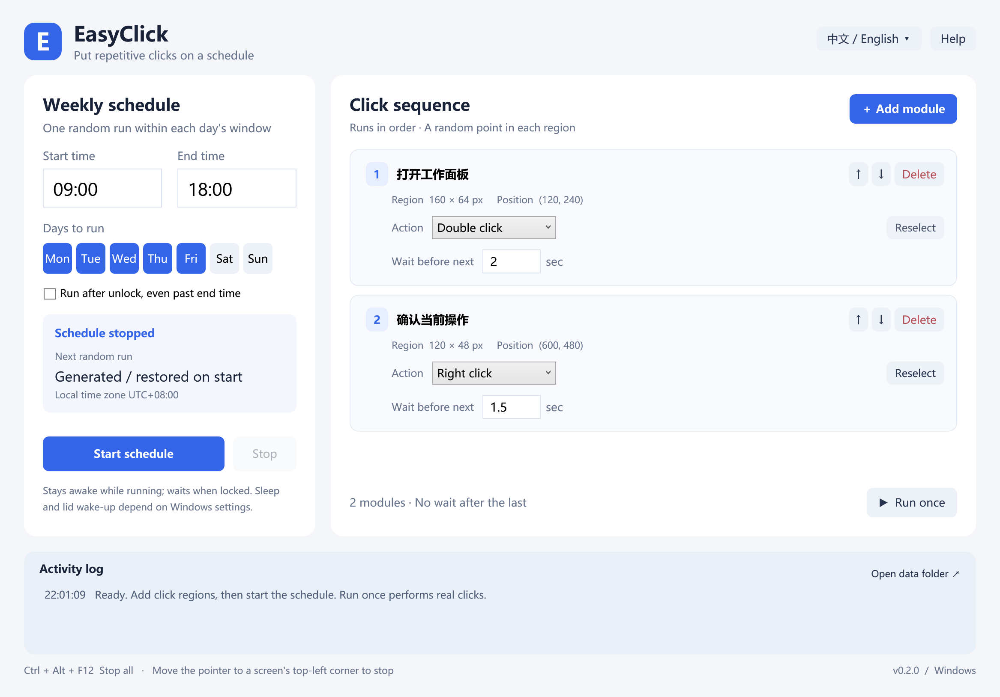

# Easy Apps Releases

Official Windows downloads and user guides for **EasyClick** and **EasyKeepAwake**. Release binaries and documentation are public; application source code stays in separate private repositories.

## Downloads

| App | Latest product release | Windows x64 download | User guide |
| --- | --- | --- | --- |
| **EasyClick** | [v0.2.0](https://github.com/YinHang2515/easy-apps-releases/releases/tag/easyclick-v0.2.0) | [EXE](https://github.com/YinHang2515/easy-apps-releases/releases/download/easyclick-v0.2.0/EasyClick.exe) / [ZIP](https://github.com/YinHang2515/easy-apps-releases/releases/download/easyclick-v0.2.0/EasyClick-0.2.0-win-x64.zip) | [EasyClick guide](apps/easyclick/README.md) |
| **EasyKeepAwake** | [v1.5.3](https://github.com/YinHang2515/easy-apps-releases/releases/tag/easykeepawake-v1.5.3) | [Portable ZIP](https://github.com/YinHang2515/easy-apps-releases/releases/download/easykeepawake-v1.5.3/EasyKeepAwake-v1.5.3-win64.zip) | [EasyKeepAwake guide](apps/easykeepawake/README.md) |

Use the link for your app. The shared Releases page contains versions of both products.

## EasyClick

Schedule a click sequence on selected weekdays, at a random time within a daily window. Freeze the screen to select click regions, choose single-click, double-click, or right-click actions, and set delays between modules. The interface supports English and Chinese.

Download `EasyClick.exe` and run it. No installer or separate .NET runtime is required. SHA-256 checksums are included with each release.

## EasyKeepAwake

[Official website](https://mango-forest-003c80100.4.azurestaticapps.net)

Keep your Windows session active with configurable idle-time mouse clicks or keystrokes. Simulated input pauses during reported media playback, with a music-only exception for NetEase CloudMusic. Optional lid keep-awake controls are available.

Extract the **entire** `EasyKeepAwake-v1.5.3-win64.zip` archive, then run `EasyKeepAwake.exe` from the extracted app folder. Keep the EXE and `_internal` folder together. No Python installation is required. The release notes include the ZIP's SHA-256 digest.

## Updating and compatibility

Exit the app from its tray icon before replacing a running copy. Follow the product guide for its settings location and update instructions.

Screen locking and actual sleep impose Windows limitations on simulated input. Read the relevant product guide for its behavior; neither app promises clicks on a locked desktop or during sleep.

This repository was previously named `easykeepfocus-releases` (and earlier `focuskeeper-releases`). Existing EasyKeepFocus tags, assets, and download links remain available through GitHub redirects. The product is now named EasyKeepAwake.

Maintainers: see [Publishing releases](PUBLISHING.md) for tag names, asset checks, and publication rules.
