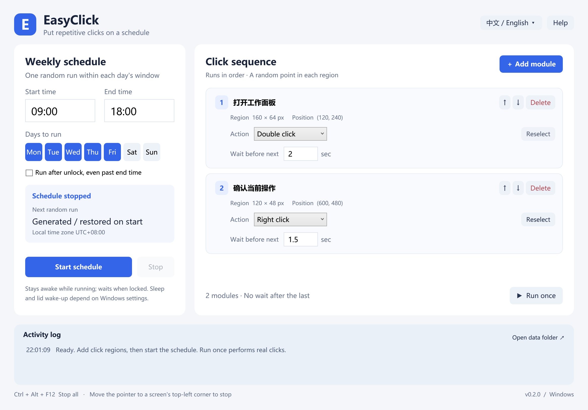
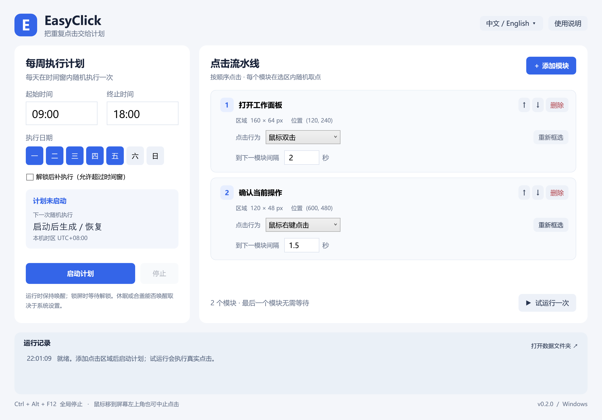

# EasyClick

A local Windows tool for scheduled, randomized clicks. Choose days of the week and a daily time window, then run a sequence of modules that click within selected screen regions. Each module supports single, double, or right clicks. The interface supports English and Chinese.

## Download and use

Download `EasyClick.exe` from the public [EasyClick v0.2.0 release](https://github.com/YinHang2515/easy-apps-releases/releases/tag/easyclick-v0.2.0) and double-click it. Alternatively, download the ZIP, extract it, and run the EXE inside. Supports **Windows 10 / 11 x64**. No installation or separate .NET runtime is required.

The source repository remains private. The shared [Easy Apps releases repository](https://github.com/YinHang2515/easy-apps-releases) contains public release binaries and documentation. The portable package includes the .NET runtime and extracts required runtime libraries to the system temporary directory on first launch. It does not install a system service.

Use the language selector in the top-right corner to switch between **Chinese / English**. Changes take effect immediately and are saved locally. Existing module names stay unchanged; new modules use the default name in the selected language.

1. Enter a start and end time, such as `09:00`–`18:00`, and choose the days to run each week.
2. Choose **＋ Add module**. The screen freezes and a selection overlay appears. Drag a region and release to confirm; press Esc or right-click to cancel.
3. Set the module name, action, and **Wait before next** delay in seconds; decimals are supported. Use ↑ / ↓ to change the order. There is no delay after the last module.
4. Choose **Start schedule**. Each selected day gets one run at a random time within that day's remaining window. The selected time is saved; restarting the same schedule restores a pending run's original time.
5. **Run once** performs real clicks: the window minimizes, waits 3 seconds, and starts the sequence. This does not use up the day's scheduled run.

| Action | Behavior |
| --- | --- |
| Single click (default) | Choose a random point in the region and send one physical left-button click |
| Double click | Choose a random point in the region and send two physical left-button clicks at that same point |
| Right click | Choose a random point in the region and send one physical right-button click |

The delay between modules starts after the module's complete click action finishes. Older configurations without an action use single click; configurations without a language preference use Chinese.

**Ctrl + Alt + F12** stops all schedules and clicks. You can also stop from the system tray. Before each module runs, a pointer in the top-left 3×3-pixel area of any display triggers a safety stop.

Closing the main window while a schedule is active hides it in the system tray. Choose **Exit** from the tray to quit. EasyClick does not start with Windows; after quitting or restarting the computer, reopen the EXE and start the schedule.

## Locking, sleep, and closing the lid

When Windows locks, the original session's desktop and applications remain open, but Windows switches to a secure desktop. The current mouse simulation cannot deliver clicks to the original desktop while it is locked. Clicking also pauses during a UAC secure desktop prompt or a Remote Desktop disconnection. The program cannot run while the computer sleeps. EasyClick does not bypass sign-in or store login passwords.

| State | Behavior |
| --- | --- |
| EasyClick is running and the desktop is available | At the scheduled time, click a random point in each region, in module order |
| A schedule has started | Request that the system and display stay awake, and try to set a wake timer |
| Windows is locked or Remote Desktop is disconnected | Wait for unlock or reconnection; check again before each module |
| The sequence is unfinished at the end time | By default, skip that day's run or cancel remaining clicks, then wait for the next scheduled run |
| **Run after unlock, even past end time** is enabled | A saved pending run can execute after its time window ends, once the desktop becomes available |
| The computer sleeps or its lid closes | Wake-up depends on hardware and Windows power settings and is not guaranteed. The desktop must still be available after waking |
| The process exits during a sequence | Mark that day's run as handled; do not automatically replay modules that may already have clicked |

To run with the lid closed, you can set **When I close the lid: Do nothing** in Windows **Power Options → Choose what closing the lid does**, with adequate power and ventilation. EasyClick does not change this setting. It cannot prevent manual sleep, shutdown, a forced system lock, or battery depletion. Keeping the device awake uses more power; stop the schedule when finished.

Windows API references: [SendInput](https://learn.microsoft.com/windows/win32/api/winuser/nf-winuser-sendinput), [SetThreadExecutionState](https://learn.microsoft.com/windows/win32/api/winbase/nf-winbase-setthreadexecutionstate), and [SetWaitableTimer](https://learn.microsoft.com/windows/win32/api/synchapi/nf-synchapi-setwaitabletimer).

## Region and scheduling rules

- Regions are saved in physical screen pixels, with support for negative coordinates, multiple displays, and mixed scaling. Selections can span displays; clicks fall only where the region intersects an actual display, never in gaps between displays.
- Keep the target window's position, size, and content stable. Clicks use coordinates; EasyClick does not recognize buttons, window titles, or page content. Use **Reselect** to update a region.
- A display layout or system time change stops the active schedule. Check the settings before restarting it.
- Clicks use Windows `SendInput`. The target application must not run with higher privileges than EasyClick. EasyClick runs as a standard user by default and does not require administrator privileges.
- Times use the current Windows local time zone and the interval `[start time, end time)`. Overnight windows are not supported. If today's window has already ended when the schedule starts, the next selected day is scheduled. Runs are not created retroactively for all the days the app was closed.
- A time skipped by daylight saving time moves forward to the first valid minute. An ambiguous time uses its first occurrence. A scheduled run completed or interrupted on a given day will not run again that day after stopping, restarting, or changing the configuration.
- Under the default policy, each module's click action must begin within the time window. A long sequence may be canceled if it starts near the end time. Widen the window or enable **Run after unlock, even past end time** if needed.
- Schedule and module settings are locked while the schedule is active. Stop it before editing. Delays range from 0 to 86400 seconds, with up to 100 modules.

## Local data

Data is stored in `%LOCALAPPDATA%\EasyClick`. Choose **Open data folder** in the app to open it:

| File | Contents |
| --- | --- |
| `settings.json` | Interface language, weekly schedule, module names, regions, actions, delays, and order |
| `runtime.json` | Saved random run times and daily execution state, used for recovery and duplicate prevention |
| `activity.log` | Local activity log; one rotated copy is retained when the log reaches about 5 MB |

Settings are saved using temporary files and atomic replacement. Invalid JSON is first backed up with an `.invalid-timestamp` suffix, then defaults are loaded. EasyClick does not upload settings, screenshots, or click records. It contains no telemetry and does not check for updates in the background. Frozen screenshots are used only for the current region selection and are not saved to disk. Delete the EXE and the data folder to remove the app and its settings.

Release packages are unsigned. Compare the release's `SHA256SUMS.txt` with the output of PowerShell `Get-FileHash .\EasyClick.exe -Algorithm SHA256` to verify file integrity.
